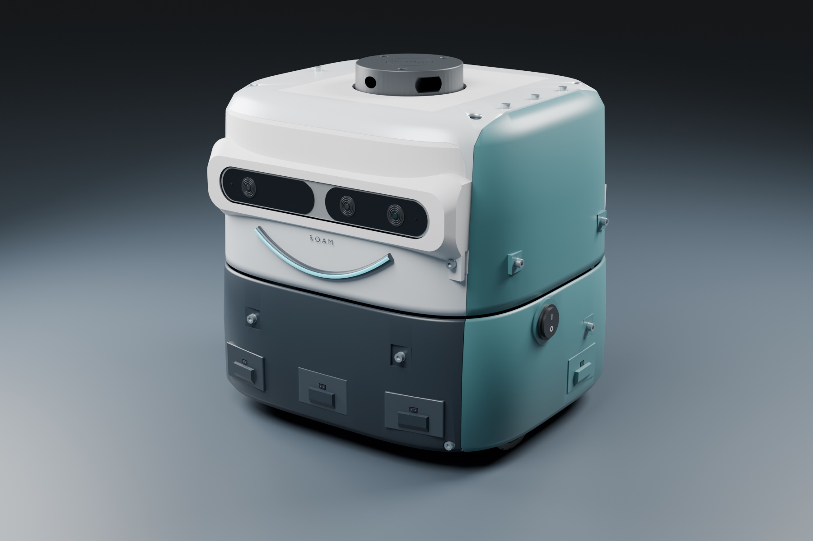
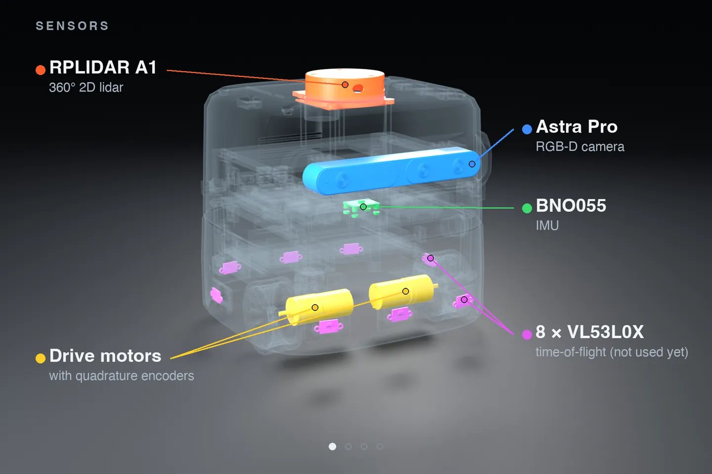
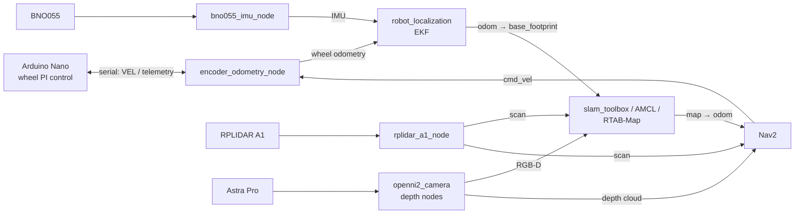

<p align="center">
  
</p>

# Roam-E

Roam-E is an indoor mobile robot built from scratch: a 3D-printed
differential-drive base with a 2D lidar, an RGB-D camera and an IMU, running
ROS 2 Jazzy on a Raspberry Pi 5. It maps rooms, localizes itself on a saved
map and drives to goals on its own while avoiding obstacles.

This repository holds the whole robot: the ROS 2 software, the Arduino motor
firmware, the robot description (URDF), and the Blender model and STL files of
the printed body.

## What it does

- **Wheel control.** An Arduino Nano runs a closed-loop velocity controller
  for each wheel (PI with per-wheel feed-forward and a breakaway assist for
  starting from standstill), up to 0.43 m/s. Motors stop if commands stop
  arriving: after 250 ms on the ROS side and 350 ms in the firmware.
- **Odometry.** Wheel-encoder odometry and the BNO055 gyro are fused with an
  EKF (`robot_localization`).
- **Mapping.** 2D lidar SLAM with `slam_toolbox`, and 3D mapping with RTAB-Map
  using the RGB-D camera, the lidar and the wheel odometry.
- **Localization.** AMCL on saved 2D maps, with an optional automatic
  global-localization maneuver, or RTAB-Map localization on its 3D map. When
  RTAB-Map loses track, a learned-feature relocalizer (XFeat + LighterGlue +
  PnP) matches the camera image against keyframes of the map and resets the
  pose.
- **Navigation.** Nav2 with Regulated Pure Pursuit, a velocity smoother and a
  collision monitor. The depth camera adds obstacles below the lidar plane to
  the local costmap.
- **Teleoperation and visualization.** Foxglove for driving, sending goals and
  viewing the robot; keyboard teleop over SSH.

## Hardware

<p align="center">
  
</p>

| | Component | Role |
|---|---|---|
| **Sensors** | Slamtec RPLIDAR A1 | 360° 2D lidar |
| | Orbbec Astra Pro | RGB-D camera, facing forward |
| | Bosch BNO055 | IMU, used in IMU-only fusion mode (no magnetometer) |
| | Quadrature encoders on both motors | Wheel odometry |
| | 8 × VL53L0X | Time-of-flight sensors around the base; mounted, not yet used by the software |
| **Actuators** | 2 × 12 V geared DC motors | Differential drive, with a passive caster at the rear |
| | 2 × DRV8871 | H-bridge motor drivers |
| **Compute** | Raspberry Pi 5 (8 GB) | Main computer, Ubuntu 24.04 + ROS 2 Jazzy |
| | Arduino Nano | Wheel velocity control and encoder counting, USB serial to the Pi |
| | TCA9548A | I²C multiplexer for the ToF sensors |
| **Power** | 3S LiPo, 11.1 V, 3300 mAh | Battery, in a slide-out drawer |
| | Geekworm Pi5-5V5APD | 5 V / 5 A supply for the Pi |
| | 2 × rocker switches | Battery and wheel power |

The body is about 240 × 215 × 235 mm and made of 47 different printed parts,
mostly PETG, printed on a Creality K1C. The skirt panels slide off
horizontally for service and the battery sits in a drawer at the rear. The Blender assembly, all STL files and the parts list are in
[`mechanical/`](mechanical/).

## Software



The Pi turns body velocity commands into wheel targets in ticks per second and
sends them to the Nano, which closes the loop on the encoders and streams
telemetry back. Everything above the Nano is ROS 2.

| Launch file | Starts |
|---|---|
| `sensors_viz.launch.py` | Sensors, wheel odometry, EKF and robot model. Motors stay disarmed |
| `drive.launch.py` | The above plus the Foxglove bridge, with the motors armable for teleop |
| `mapping.launch.py` | 2D SLAM with `slam_toolbox` |
| `localization.launch.py` | AMCL on a saved map |
| `navigation.launch.py` | Nav2 on a saved map, localized with AMCL or RTAB-Map |
| `rtabmap_mapping.launch.py` | RTAB-Map 3D mapping, or localization on a saved database |
| `astra_camera.launch.py` | RGB-D camera and the depth obstacle cloud |

### Repository layout

```text
src/roam_e/               ROS 2 package: nodes, launch files, EKF / SLAM / AMCL / Nav2 config
src/roam_e_description/   URDF / xacro robot model, TF frames and RViz setup
firmware/                 Arduino Nano motor controller, AVR build script and host-side unit tests
mechanical/               Blender assembly, STL print files and parts list
maps/                     Saved slam_toolbox maps
scripts/setup/            Raspberry Pi 5 bootstrap, backup and hardware validation
scripts/bno055/           IMU calibration tools
scripts/camera/           RGB and depth camera calibration tools
tools/                    Visual relocalizer, camera calibration checks, robot-model export from CAD
config/                   IMU calibration and systemd units
docs/                     Usage guide and research notes
```

## Getting started

On a Raspberry Pi 5 with Ubuntu 24.04 Server (64-bit):

```bash
git clone https://github.com/igsova/Roam-E.git ~/Roam-E
cd ~/Roam-E
scripts/setup/bootstrap_pi5.sh --upgrade-os
sudo reboot
```

The bootstrap installs ROS 2 Jazzy and the workspace dependencies, enables the
IMU's I²C bus and builds the workspace. It never moves the motors. After the
reboot, check the hardware without moving, then start the sensors:

```bash
cd ~/Roam-E
scripts/setup/validate_hardware.sh
source /opt/ros/jazzy/setup.bash
source install/setup.bash
ros2 launch roam_e sensors_viz.launch.py use_rviz:=false
```

Driving, mapping, localization and navigation are covered step by step in
[`docs/usage.md`](docs/usage.md).

## Documentation

- [Usage guide](docs/usage.md): driving, mapping, localization, navigation and
  Pi setup.
- [RGB-D camera setup](CAMERA_CAPTURE.md) and
  [camera calibration](scripts/camera/README.md).
- [Visual SLAM research notes](docs/research/): what runs on a Pi 5 CPU and
  measurements on this robot.
- [Mechanical design](mechanical/README.md): parts, printing and assembly.
