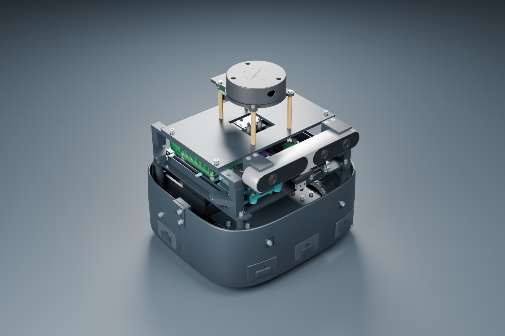

# Mechanical design

  

Roam-E's body is fully 3D-printed and modelled in Blender. This folder holds
the version of the robot that is built and running.

## Files

| Path | Contents |
|---|---|
| [`roam_e.blend`](roam_e.blend) | Complete assembly: printed parts, electronics, sensors, fasteners and ToF wiring. Collections group it by sub-assembly. The scene camera reproduces the render in the main README |
| [`stl/printed/`](stl/printed/) | Structural parts, PETG |
| [`stl/spacers/`](stl/spacers/) | PCB, caster and hood spacers, PETG |
| [`stl/soft/`](stl/soft/) | Pads and dust plugs, TPU or cut from foam tape |
| [`parts.csv`](parts.csv) | Every part with its quantity, printed size, material and whether it needs supports |

File names end in the quantity to print, e.g. `P17_tof_board_retainer_qty8.stl`.
In total that is 47 different parts and 119 printed pieces.

## Sub-assemblies

| Group | Parts |
|---|---|
| Chassis and drive | P01 chassis plate, P03 pylons (×4), P02 caster spacers (×4), P191–P194 chassis cleats |
| Electronics deck | P04 deck with cable channels, C01–C09 board carriers, S01–S09 PCB spacers, P20 multiplexer clips |
| Battery drawer | P05 drawer, P06L / P06R guides, F04 liner |
| Sensor frame | P07L / P07R frames, P10 lidar plate, P09 camera clamps, F01–F03 camera pads |
| Hood | P15C front hood with camera surround, P15D rear hood with lidar opening, P15B side panel, P12 locating sleeves, P14 roof plugs |
| Skirt | P16C front, P16D rear and P16B right panel (with the wheel power switch), P17 ToF retainers (×8), P18 ToF pads (×16) |

The lidar stands on four 44.78 mm brass posts on the P10 lidar plate. The
depth camera is clamped to the front of the sensor frame by the P09 caps, on
compliant pads, behind the hood's camera surround.

## Printing

- STLs are in millimetres and already oriented for printing. Import them at
  100 %.
- The largest part, P16D, is 213.5 × 122.6 mm. It fits a 220 mm bed with at
  most a 2 mm brim.
- The parts were sliced for a Creality K1C with PETG, 0.20 mm layers, 4 walls
  and 20 % infill.
- `parts.csv` marks which parts need supports. The hood and skirt panels need
  a look in the slicer around the camera bridge, wheel arches, ToF windows and
  nut pockets.

## Hardware

Joints are mostly M3 screws with nuts held in printed pockets; the boards use
M2.5 and M2. Screws as modelled in `roam_e.blend`, with matching nuts and
washers:

| Size | Qty |
|---|---:|
| M3 × 10 | 18 |
| M3 × 12 | 32 |
| M3 × 16 | 4 |
| M3 × 25 | 4 |
| M3 × 35 | 4 |
| M2.5 × 8 | 16 |
| M2.5 × 10 | 6 |
| M2.5 × 12 | 6 |
| M2.5 × 20 | 12 |
| M2 × 6 | 2 |
| M2 × 20 | 4 |

Plus two round rocker switches: battery power on the drawer and wheel power on
the right skirt panel.

## Service

- **Battery:** slide the drawer out from the rear.
- **Skirt panels:** they slide off horizontally while the chassis cleats stay
  in place. Remove the right panel (P16B) first, then the front (P16C), then the
  rear (P16D). Reassemble in the reverse order. Disconnect the battery and
  unplug the ToF and switch leads before moving a panel.

## ROS model

The visual meshes and sensor frames of the ROS description in
[`src/roam_e_description`](../src/roam_e_description) are exported from this
model with [`tools/export_blender_description.py`](../tools/export_blender_description.py).
